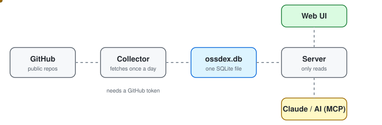

# ossdex

<p align="center"></p>

**ossdex finds popular open-source projects on GitHub and lets you search them.**

It saves each project's link, description, topics, language, license, stars, forks and README into one
SQLite file. It also saves the star count every day, so you can see which projects are **growing fast**.
You can then browse the data in three ways: a website, a JSON API, or an AI assistant (MCP).

All data comes from the GitHub API. Nothing else.

<p align="center"></p>

## The two programs

| program | what it does |
|---|---|
| `ossdex-collector` | Talks to GitHub. Finds repos, reads READMEs, saves daily star counts. **Writes** the database. |
| `ossdex-server` | Shows the data: website, API (`/api`) and MCP (`/mcp`). **Only reads** the database. Never needs a token. |

They share one file: `data/ossdex.db`. (A third package, `ossdex-core`, holds code both use.)

## Quick start

```sh
uv sync --all-packages
cp .env.example .env            # put your GITHUB_TOKEN in it
(cd web && npm install && npm run build)

uv run --package ossdex-collector ossdex-collector discover --dry-run   # how many repos? (nothing is saved)
uv run --package ossdex-collector ossdex-collector update               # fetch everything (first run is long)
uv run --package ossdex-server ossdex-server serve                      # open http://127.0.0.1:8200
```

**GitHub token:** a classic personal access token with **no scopes** is enough, because the data is
public. Put it in `.env` as `GITHUB_TOKEN`. If it is empty, ossdex tries `gh auth token`. The token is
only sent to `api.github.com` and is never printed. Only the collector uses it.

The server can run while the collector writes, and it clears its cache by itself when new data arrives.

## Which repos are collected?

A repo is kept when it:

- has at least **1,000 stars** (you can change this),
- is **not** a fork, mirror, template or archived repo,
- has a **license** GitHub recognises,
- does not have an excluded topic (`awesome-list`, `awesome`, `books`, `tutorial`, `interview`).

If a repo stops matching later, it is **hidden**, not deleted.

**Star threshold:** set `OSSDEX_MIN_STARS` or use `--min-stars N`.

- Lower it → more repos get added.
- Raise it → repos below it are hidden (lower it again and they come back). `ossdex-collector prune` deletes them for good.
- Try `discover --dry-run --min-stars 500` first to see how many repos you would get.

**No license?** Skipped by default, because code without a license is not really open source. Set
`OSSDEX_REQUIRE_LICENSE=false` to keep them (the UI marks them "no license").

## Star growth needs time

GitHub only tells us the star count **today**. So ossdex saves a snapshot **every day it runs**, and
works out "stars gained in 7 / 30 days" from those snapshots.

- The 7-day column fills in after a week. The 30-day column after a month.
- Missed a day? No problem, it uses the closest older snapshot.
- Run `ossdex-collector schedule install` so it happens daily.

## Commands

| command | what it does |
|---|---|
| `discover [--min-stars N] [--dry-run] [--budget P]` | search GitHub for matching repos and save them (can be resumed) |
| `refresh` | re-check repos that were not returned: deleted, now a fork, archived, renamed |
| `readmes [--limit N] [--days D]` | download READMEs, biggest repos first; refetch ones older than D days (30) |
| `index [--full]` | rebuild the keyword-search index |
| `enrich [--offline]` | tag repos with the Awesome lists they appear in and the arXiv papers they link to |
| `update` | does discover → refresh → readmes → enrich → index. Safe to stop and run again |
| `prune` | delete hidden repos (asks first) |
| `status` | show what is in the database |
| `schedule install` / `remove` | run `update` daily (launchd on macOS; on Linux it prints a crontab line) |

All of these start with `ossdex-collector`. Server commands:

| command | what it does |
|---|---|
| `ossdex-server serve [--workers N]` | website + API + MCP on port 8200 |
| `ossdex-server mcp [--transport stdio\|sse\|streamable-http]` | MCP only (stdio by default, for local clients) |
| `ossdex-server claude-config [--install]` | connect Claude Desktop to this computer's ossdex (adds it to Claude's config file, keeps your other servers, saves a `.bak`) |

`--budget P` stops a run after P GraphQL points (GitHub allows 5,000 per hour), so one run never uses
your whole quota.

## Connect an AI assistant (MCP)

ossdex has an MCP server with **24 tools** and **13 prompts**. It calls no LLM and no GitHub.
Every client connects to one URL:

- **Local:** `http://127.0.0.1:8200/mcp` (while `ossdex-server serve` is running)
- **Hosted:** `https://ossdex.<your-domain>/mcp` (see [Hosting it publicly](#hosting-it-publicly))

Cloud apps (claude.ai, ChatGPT) cannot reach `127.0.0.1`, so they need the hosted URL.

<details>
<summary><b>Claude</b></summary>

- **Claude Code:**
  ```sh
  claude mcp add --transport http ossdex http://127.0.0.1:8200/mcp
  ```
- **claude.ai / Claude Desktop (hosted URL), the way most people connect:** claude.ai/customize/connectors (in Claude Desktop: Customize → Connectors) → **+ Add** → **Add custom connector**. Name `ossdex`, URL `https://ossdex.<your-domain>/mcp`, No sign in. Nothing to install. On Team or Enterprise plans an owner adds it under Organization settings → Connectors. Then in a chat open **+** → Connectors and switch ossdex on and start a question with "Use ossdex to…". The in-app **Guide** walks through this. The server must run with `OSSDEX_PUBLIC_HOST=<your-domain>`.
- **Claude Desktop, developer shortcut (local server):** run `uv run --package ossdex-server ossdex-server claude-config --install`, then fully quit Claude (⌘Q) and open it again. No Node.js needed. Without `--install` it only prints the entry. The in-app **Guide** shows these steps too.
- **Claude Desktop, by hand (local server):** the config file can only start local programs, so bridge with `mcp-remote` (needs Node.js). Merge this into `~/Library/Application Support/Claude/claude_desktop_config.json` (macOS) or `%APPDATA%\Claude\claude_desktop_config.json` (Windows), then restart:
  ```json
  {
    "mcpServers": {
      "ossdex": { "command": "npx", "args": ["-y", "mcp-remote", "http://127.0.0.1:8200/mcp"] }
    }
  }
  ```
</details>

<details>
<summary><b>Gemini</b></summary>

- **Gemini app (hosted URL):** on gemini.google.com, Settings → **Connected Apps** → Custom apps → **Add a custom app**, paste `https://ossdex.<your-domain>/mcp`, then **Next**. In a chat, type `@` and pick ossdex. It needs a personal Google account in the US with Keep Activity on.
- **Gemini CLI:**
  ```sh
  gemini mcp add --transport http ossdex http://127.0.0.1:8200/mcp
  ```
  or edit `~/.gemini/settings.json`:
  ```json
  { "mcpServers": { "ossdex": { "httpUrl": "http://127.0.0.1:8200/mcp" } } }
  ```
- **Antigravity:** Manage MCP servers → View raw config, then add to `mcp_config.json`:
  ```json
  { "mcpServers": { "ossdex": { "serverUrl": "http://127.0.0.1:8200/mcp" } } }
  ```
</details>

<details>
<summary><b>ChatGPT / Codex</b></summary>

- **No setup:** open a repo card in the web app, pick a prompt template, click **Copy**, paste into ChatGPT.
- **ChatGPT (hosted URL):** chatgpt.com/plugins → **+** → **Add custom MCP server**. Name `ossdex`, URL `https://ossdex.<your-domain>/mcp`, No authentication, then **Create as a plugin**. In a chat, type `@` and pick ossdex. If your plan has no such button, use Settings → Apps → Advanced settings → Developer mode → **Create app**.
- **Codex CLI:**
  ```sh
  codex mcp add ossdex --url http://127.0.0.1:8200/mcp
  ```
</details>

To test any setup: run `npx @modelcontextprotocol/inspector`, choose **Streamable HTTP**, and connect to the URL.

<details>
<summary><b>The 24 tools</b></summary>

- `search_repos`: keyword search over READMEs, names, topics and descriptions
- `list_repos`: filter and sort (stars, forks, gain_7d, money hints)
- `get_repo`: repo details, license, star history, README excerpt
- `find_similar`: alternatives and competitors
- `compare_repos`: compare 2–6 repos side by side
- `count_repos`: size a niche (by language, license, topic, year)
- `opportunity_report`: fastest-growing niches and rising repos
- `find_niches`: rank topics by star growth
- `get_readme_section`: search inside one repo's README
- `get_rising`: biggest star gains over 7 or 30 days
- `facets`: counts by language, license and topic
- More: `classify_artifact`, `get_runtime_dependencies`, `classify_growth`, `get_package_adoption`, `analyze_forks`, `get_maintainer_health`, `get_commercial_landscape`, `get_company_events`, `check_name_collision`, `license_audit`, `platform_compat`, `saas_base`, `evaluate_brief`

Resources: `ossdex://repo/{owner}/{name}` (README excerpt) and `ossdex://status` (database status).
</details>

<details>
<summary><b>The 13 prompts</b></summary>

1. `saas_base`: find a permissive, maintained project to build on
2. `vertical_saas_idea`: adapt a project for a regulated industry
3. `compose_product_stack`: combine several projects, with a license check
4. `fork_and_rebrand_audit`: checklist for white-labeling a fork
5. `competitive_moat_analysis`: find an underserved gap
6. `breakout_opportunity_scan`: spot fast-rising topics with few competitors
7. `freelance_niches`: platforms where businesses pay consultants
8. `oss_solution`: best open-source answer to a problem
9. `evaluate_product_brief`: check an idea against 10 failure modes
10. `articulate_repo_ideas`: 5 product ideas from one repo
11. `articulate_stack_ideas`: 4 "1+1=3" ideas from 2–6 repos
12. `learn_repo_80_20`: 80/20 learning guide for a repo
13. `learn_stack_80_20`: 80/20 guide to combining repos
</details>

## Finding paid work

ossdex shows where growth and money may be. Finding clients is up to you.

- **Growing niches:** `find_niches` ranks topics by stars gained. Fast growth with few repos means room to specialise.
- **Business hints:** `update` reads each README for words like "managed cloud", "enterprise edition", "paid support", and records funding links. Projects with these hints probably have paying customers. Filter with `money`.
- **`opportunity_report`** (MCP) combines all of the above.

### A simple 3-step routine

1. **Filter.** On the Cards page, use `License → Permissive` plus `Advanced → Business signals` to drop restrictive licenses.
2. **Check one project.** Click a card. Look at:
   - **Fork-to-star ratio ≥ 12%:** companies are cloning and self-hosting it.
   - **License:** MIT / Apache / BSD = free to use in closed-source SaaS. LGPL / MPL = fine as an unmodified dependency. AGPL = you must share source for network use, so keep it behind a separate service.
3. **Get more data.** Keep `update` scheduled daily so star gains stay fresh.

## Where to run it

- **One machine:** run both on your laptop. Simplest.
- **One VPS:** collector on cron, server under systemd, same `data/ossdex.db`. Good for a public MCP.
- **Fetch on a server, browse locally:** copy a safe snapshot:
  ```sh
  # on the server
  sqlite3 data/ossdex.db "VACUUM INTO 'data/ossdex-snapshot.db'"
  # locally (delete ossdex.db-wal and ossdex.db-shm first)
  scp server:/path/to/ossdex/data/ossdex-snapshot.db data/ossdex.db
  ```
  Never copy the live `ossdex.db` directly. Recent writes sit in `ossdex.db-wal`, and a plain copy can be corrupt.

## Hosting it publicly

`deploy/` has everything: a step-by-step `README.md`, a `Caddyfile`, a systemd unit, a cron file, an env
template and a script that limits the firewall to Cloudflare.

Then add `https://ossdex.<your-domain>/mcp` as a custom connector in Claude (no login needed). It works in the Claude mobile app too.

The public server:

- answers from the database only, with no GitHub calls and no token (data is as fresh as the last collector run)
- never looks at the machine it runs on; the caller passes OS and habits
- shows only a ~1,500 character README excerpt plus a GitHub link
- has no accounts. Limits per client IP: a rate limit (429 + `Retry-After`), a cap on requests in flight (503), a cap on query-string size (414), and 5 seconds per query
- runs one request per worker at a time, so set `OSSDEX_WORKERS` to your CPU cores. Repeated questions come from a cache. Test your machine with `scripts/loadtest.py`.

## Limits

- **GitHub search returns at most 1,000 results per query.** Discovery splits the star range (and creation date) into small slices. One star count on one day with over 1,000 repos would still be cut off; the run tells you.
- **Rate limits:** 5,000 GraphQL points per hour. The client waits for a close reset, stops cleanly on a far one (just run again), backs off on errors, and uses smaller pages if GitHub times out. A failed slice is retried next run.
- **First run is big:** about 60,000 repos at 1,000+ stars (counted in October 2026), roughly 2,500 README requests. Expect under an hour, though that is an estimate.
- **`--dry-run` is an upper bound.** License and other filters apply later, so fewer repos are saved.
- **Stars are not quality.** Young fast-rising projects and quiet libraries below the threshold are missed, and stars can be faked.
- **No past star history.** It starts the day you first run it.
- READMEs belong to their authors, so the public server shows only an excerpt.

## How it works

```
GitHub API ─► ossdex-collector ─► data/ossdex.db (SQLite, WAL) ─► search chunks (FTS5)
                                      │ read-only
                                      ▼
                         ossdex-server (one process)
                           ├─ /api  FastAPI ─► web/ (React, served from web/dist)
                           └─ /mcp  FastMCP (streamable HTTP)
```

- Server code: `repo_query.py` (filters, sorts, detail, growth), `search.py` (keyword search), `tools.py` (MCP tools), `cache.py`, `limits.py` (rate limits), `db.py` (read-only connections, query timeout).
- `repos.enrich_status` is `ok` (visible), `gone`, `filtered` (no longer qualifies) or `below` (under the threshold). The last three are hidden everywhere.
- Discovery progress is saved in the database, so a stopped run picks up where it left off.

## Settings

Collector, in `.env`:

| variable | default | meaning |
|---|---|---|
| `GITHUB_TOKEN` (or `OSSDEX_GITHUB_TOKEN`) | falls back to `gh auth token` | collector only |
| `OSSDEX_MIN_STARS` | `1000` | star threshold |
| `OSSDEX_EXCLUDE_TOPICS` | `awesome-list,awesome,books,tutorial,interview` | topics to skip |
| `OSSDEX_REQUIRE_LICENSE` | `true` | `false` keeps unlicensed repos |
| `OSSDEX_DATA`, `OSSDEX_DB` | `data`, `data/ossdex.db` | where files are stored |
| `OSSDEX_HOME` | nearest workspace root | folder with `.env`, `data/`, `web/` |

Server:

| variable | default | meaning |
|---|---|---|
| `OSSDEX_PUBLIC_HOST` | – | public hostname for MCP; also turns rate limits on |
| `OSSDEX_WORKERS` | `1` | worker processes (use your CPU core count) |
| `OSSDEX_MAX_QUERIES` | `1` | queries at once per worker |
| `OSSDEX_QUERY_TIMEOUT` | `5` | seconds per request, queue time included |
| `OSSDEX_RATE_LIMIT` | on if `OSSDEX_PUBLIC_HOST` is set | `on` / `off` |
| `OSSDEX_RATE_WEB`, `OSSDEX_RATE_MCP` | `120`, `600` | requests per minute per IP for `/api` and `/mcp` |
| `OSSDEX_MAX_INFLIGHT_API`, `OSSDEX_MAX_INFLIGHT_MCP` | `64`, `32` | requests handled at once per process |
| `OSSDEX_TRUSTED_PROXIES` | – | extra proxy addresses whose `CF-Connecting-IP` is trusted |
| `OSSDEX_WEB_DIST` | `web/dist` | where the built UI is |

## Tests

`uv run pytest` runs offline, using a fake GitHub and a sample database.
`cd web && npm run build` type-checks and builds the UI.

## Origin

ossdex began as a copy of `trenshift-web` (the UI and MCP code), with its own collector and database.
They share no files at run time, so a fix to the shared parts may need to be made in both.
